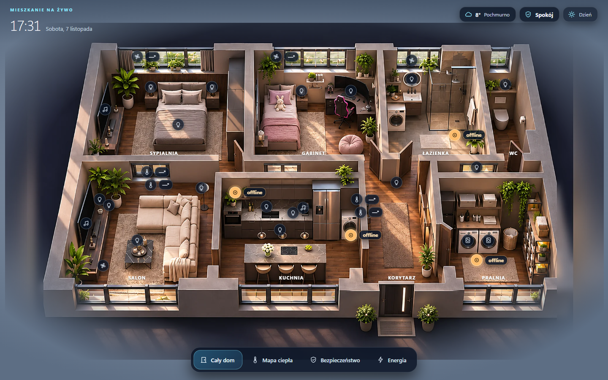

# Mieszkanie na żywo · Home Assistant

Mieszkanie pokazuje dom jako izometryczną makietę. Pokoje reagują na światła i porę dnia, znaczniki pokazują stany czujników, a widok energii rysuje przepływ prądu do pracujących urządzeń. Kliknięcie pomieszczenia przybliża je i otwiera jego sterowanie.

To darmowa wersja społecznościowa Krystal Twin. Zawiera przykładową makietę z trzema wariantami oświetlenia oraz konfigurację z przykładowymi encjami.



## Instalacja ręczna

1. Pobierz archiwum z tego repozytorium i rozpakuj je.
2. Skopiuj katalog `custom_components/krystal_twin` do katalogu `custom_components` w konfiguracji Home Assistant. Po skopiowaniu powinien istnieć plik `config/custom_components/krystal_twin/manifest.json`.
3. Otwórz `config/custom_components/krystal_twin/frontend/layout.json` i zastąp identyfikatory `*.demo_*` własnymi. Identyfikatory znajdziesz w **Narzędzia deweloperskie → Stany**. Wstawiaj encje tego samego typu, np. `light.demo_1` → `light.salon`. Na początek wystarczy jedno pomieszczenie. Przykładowe encje bez odpowiednika mogą pokazywać brak danych.
4. Uruchom ponownie HA. W **Ustawienia → Urządzenia i usługi → Dodaj integrację** wyszukaj **Krystal Twin (Mieszkanie na żywo)**.
5. Otwórz **Mieszkanie** na pasku bocznym. Po zmianie `layout.json` przeładuj integrację i odśwież panel.

Panel używa sesji użytkownika HA i jego uprawnień do encji. Działa jako integracja z własnym panelem bocznym. Do ręcznej instalacji nie potrzebujesz HACS ani kompilatora.

## Pokoje Mieszkanie i Kocia strefa

Po zainstalowaniu integracji Mieszkanie:

1. W **Ustawienia → Dashboardy → Zasoby** dodaj adres `/krystal_twin_static/mieszkanie-rooms-card.js` jako **Moduł JavaScript**. Jeśli nie widzisz zakładki Zasoby, włącz tryb zaawansowany w profilu HA.
2. Utwórz osobny dashboard **Pokoje Mieszkanie** z adresem `mieszkanie-pokoje`. Możesz ukryć go na pasku bocznym, bo makieta otwiera go skrótami.
3. W edytorze nowego dashboardu otwórz **Edytor konfiguracji RAW**, wklej zawartość [pokoje-mieszkanie.json](pokoje-mieszkanie.json) i zapisz. JSON jest poprawnym zapisem konfiguracji YAML w tym edytorze.
4. Zamień przykładowe identyfikatory `*.demo_*` na własne. Te same identyfikatory w pliku makiety i w konfiguracji pokoi oznaczają to samo urządzenie. Zapisz i odśwież HA.
5. Z makiety wybierz pokój i użyj **Wejdź do pokoju**. W Gabinecie jest też skrót do Kociej strefy. Jeśli nie masz drukarki, kuwety lub karmnika, usuń ich przykładowe konfiguracje według potrzeb.

Zdjęcia pokoi i sceny Kociej strefy są w paczce. Podglądy kamer i sterowanie urządzeniami wymagają odpowiadających im encji HA.

## Dopasowanie do swojego domu

- `layout.json` zawiera przypisania urządzeń, skróty sterowania, nazwy i encje podsumowania. Powtarzające się identyfikatory zastąp konsekwentnie w całym pliku.
- `frontend/twin/` w katalogu integracji zawiera rendery `day.webp`, `night.webp` i `lit.webp`. Własne obrazy powinny mieć ten sam kadr i proporcje 16:9.
- Jeśli układ pokoi się różni, zmień obrysy i punkty urządzeń w `frontend/src/twin/scene.json` w źródłach. Same obrazy nie przesuwają znaczników.
- W pakiecie jest też osobny dashboard **Pokoje Mieszkanie** z Pomieszczeniami i Kocią strefą.

## Budowanie

Gotowy panel jest w katalogu integracji. Do przebudowania źródeł użyj Bun:

```sh
cd frontend
bun install --frozen-lockfile
bun run build
```

Następnie przeładuj integrację w HA. Zasoby grafiki są opisane w [ART-NOTICE.md](ART-NOTICE.md).

## Podziel się swoją wersją

Jeśli zrobisz własną wersję makiety, wrzuć zrzut albo opisz zmiany w Issues. W zgłoszeniu błędu podaj wersję HA i przeglądarkę. Przed dołączeniem własnego `layout.json` usuń z niego prywatne dane.
